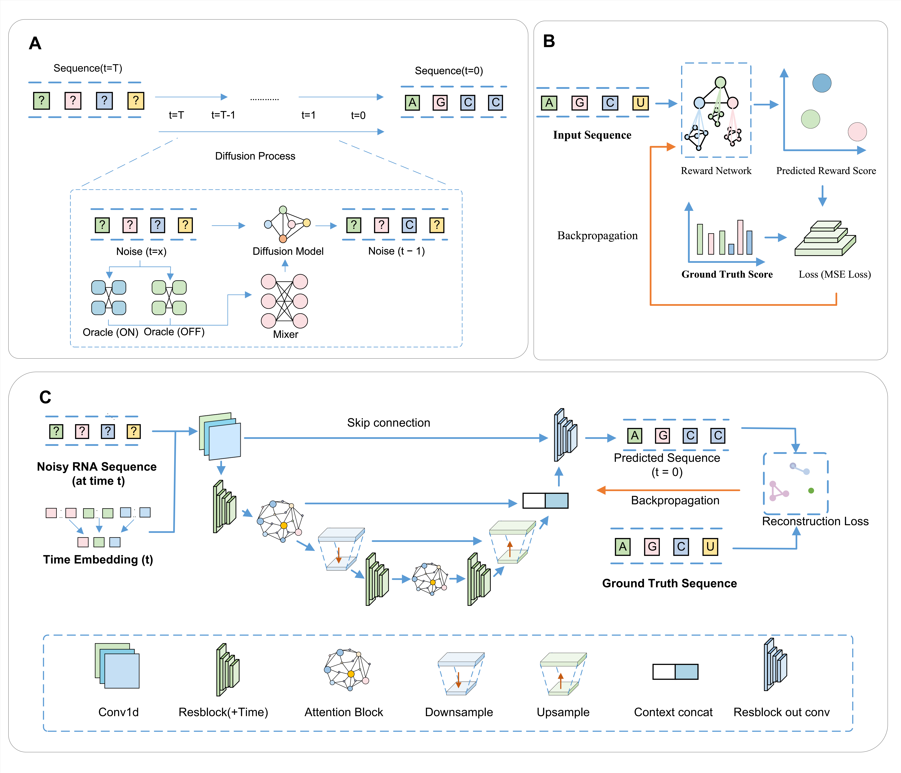

# RNADGG

Gradient-guided diffusion for functional regulatory RNA sequence design.

RNADGG combines a Gaussian diffusion model with function predictors trained on experimental RNA libraries to generate sequences toward desired activity. This repository contains the shared model components, gradient guidance, data-loading utilities, a compact RBS example, UTR experiments and the grouped toehold weight series. The predictor class retains the name `OracleCNN` for compatibility with earlier code.

This repository distributes code and usage instructions. Experimental result tables, performance figures, generated sequence libraries and trained weights are not included. Running the scripts writes outputs locally.

<p align="center">
  
</p>

## Repository structure

```text
RNADGG/
  rnadgg/       Python package for sequence utilities, models, data loading and diffusion helpers
  scripts/      Small command-line utilities for smoke tests and dataset inspection
  configs/      Example experiment configuration files
  data/         Local data directory, not tracked by git
  models/       Local checkpoints, not tracked by git
  results/      Local generated outputs, not tracked by git
  docs/         Data, reproducibility and code organization notes
```

The `rnadgg/` package is the main entry point. Development notebooks, debug scripts, generated outputs and local checkpoints are not included in the repository.

## Installation

Python 3.10 or newer is required. A CUDA-capable GPU is recommended for training, although the smoke test and unit tests can run on CPU.

```bash
git clone https://github.com/wangkeyao45-stack/RNADGG.git
cd RNADGG
python -m venv .venv
source .venv/bin/activate
pip install -e .
```

On Windows PowerShell, use:

```powershell
python -m venv .venv
.\.venv\Scripts\Activate.ps1
pip install -e .
```

For CUDA-enabled PyTorch, install the appropriate PyTorch build from the official PyTorch instructions before installing the package.

## Quick checks

Run the package smoke test:

```bash
python -m rnadgg.smoke
```

or:

```bash
python scripts/run_smoke_test.py
```

Run the regression tests:

```bash
python -m unittest discover -s tests -v
```

Inspect a dataset after placing it under `data/processed/`:

```bash
python scripts/inspect_dataset.py data/processed/rbs_data.csv --label-column rl
```

## Data

Full CSV datasets are not tracked in git. Place the processed files below under `data/processed/` before running full experiments:

```text
rbs_data.csv
rbs_data_f.csv
utr_data.csv
toehold_data.csv
toehold_data_f.csv
```

The raw 5-prime UTR library can be placed at:

```text
data/raw/GSM3130443_designed_library.csv
```

See [docs/DATA.md](docs/DATA.md) for dataset provenance.

## RBS example workflow

The package provides shared building blocks for sequence encoding, function-predictor training, the 1D U-Net denoiser and guided diffusion sampling. A small RBS workflow is provided as:

```bash
python scripts/run_diffusion_rbs.py \
  --data data/processed/rbs_data.csv \
  --label-column rl \
  --guidance-scale 1.0 \
  --output-dir results/rbs_diffusion_g1
```

The guidance scale, number of diffusion steps, number of generated sequences and output directory can be changed from the command line.

The output directory contains `generated_sequences.csv`, the predictor and denoiser checkpoints, and `run_config.json` with the run settings. Each `oracle_score` is calculated from the one-hot encoding of the exported sequence after nucleotide decoding. Scores are raw predictor outputs, without clipping to the training-label range.

## Diffusion implementation

`GaussianDiffusion` implements a DDPM with standard Gaussian noise, a linear beta schedule and a U-Net trained to predict the added noise. Generation starts from Gaussian noise and applies the reverse updates, with optional predictor gradients, before argmax nucleotide decoding. The input uses A/C/G/T channels; RNA U is mapped to the T channel.

See [docs/DIFFUSION.md](docs/DIFFUSION.md) for the equations and their implementation, including the distinction between the one-hot input mean of 0.25 and the noise mean of 0.

## UTR and toehold experiments

The UTR benchmark uses the 280,000-row `processed_data.csv` table with `r1` activity labels. The toehold benchmark uses 44,859 rows and groups duplicate full sequences before splitting.

```bash
python scripts/run_diffusion_utr.py --data data/processed/processed_data.csv --profile main
python scripts/run_diffusion_utr.py --data data/processed/processed_data.csv --profile guidance
python scripts/run_diffusion_toehold.py --data data/processed/toehold_data_f.csv
```

The main UTR comparison uses seeds 42, 43, 44, 123 and 456, with 2,048 sampled records per method. The grouped toehold series uses seeds 42, 43 and 44, with 1,024 sequences for unguided generation and each of five ON/OFF weight settings. Full runs train models and require substantial compute. Use `--dry-run` to validate the input and export splits, or `--smoke --seeds 42 --device cpu` for a small execution check. Smoke results are marked as validation-only.

The installed commands `rnadgg-utr` and `rnadgg-toehold` accept the same arguments. See [docs/EXPERIMENTS.md](docs/EXPERIMENTS.md) for settings, outputs and the differences between current manuscript settings and the archived UTR comparison.

## Scope of this release

The RBS command is a compact example. The UTR and grouped-toehold commands provide task-specific training and generation, split manifests, checkpoints and result tables. Exact historical reproduction also requires the original processed datasets and archived sequence libraries. The historical UTR predictor, diffusion minibatch and clipping range differ from the current manuscript; both configurations are documented, and the current manuscript settings are the default. Figure 5's separate unprojected 200-sequence analysis and independent-predictor rescoring are not yet provided as frozen reproduction pipelines.

See [docs/REPRODUCIBILITY.md](docs/REPRODUCIBILITY.md) for details.

## Development checks

```bash
python -m unittest discover -s tests -v
python scripts/check_release.py
```

GitHub Actions runs the checks on CPU with Python 3.10 and 3.12. The release check inspects tracked and candidate files while excluding ignored datasets, checkpoints and local environments.

## Output policy

Generated checkpoints, logs, figures and sequence libraries should be written to `models/` or `results/`. These directories are ignored by git. For publication-level reproducibility, archive generated sequence libraries and benchmark tables in a data repository such as Zenodo, Figshare, OSF or an institutional repository.

## Citation

If you use this code, please cite the associated RNADGG manuscript and the original dataset papers listed in [CITATION.cff](CITATION.cff).

## License

This repository is released under the GNU General Public License v3.0. See [LICENSE](LICENSE).
